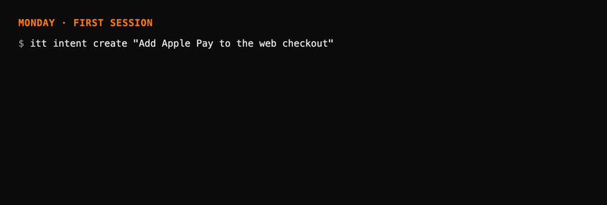
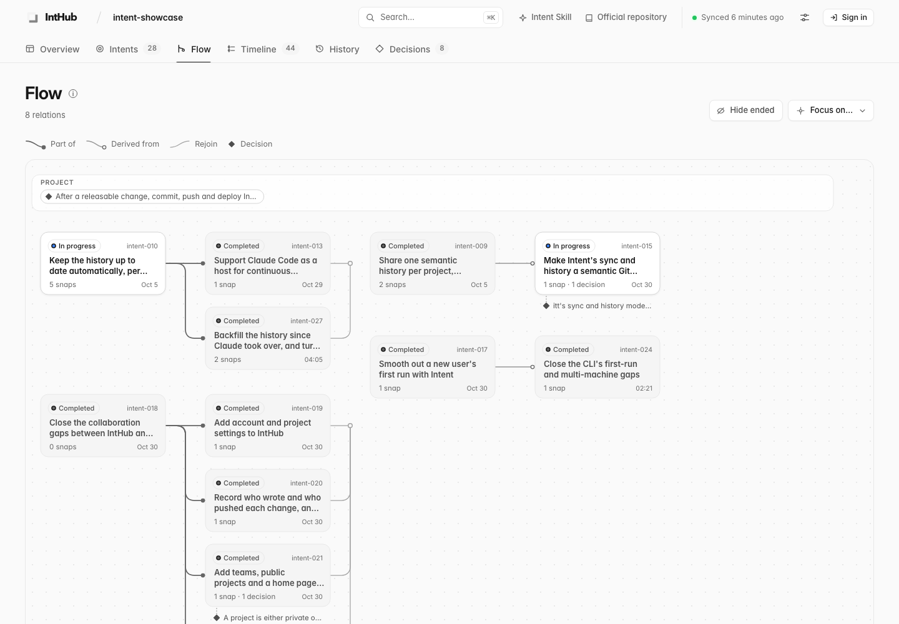

# Intent CLI

Semantic Git for the vibe coding era

[](https://github.com/dozybot001/Intent/actions/workflows/test.yml)
[](https://pypi.org/project/intent-history/)


[Website](https://tenonai.cn/products/intent/) · [Docs](https://github.com/dozybot001/Intent#docs) · [IntHub](https://inthub.tenonai.cn) · [简体中文](https://github.com/dozybot001/Intent/blob/main/README.zh-CN.md)



Your coding agent forgets where you left off. Intent keeps the goal, the latest verified checkpoint and the standing decisions in your project, so the next session continues the work instead of rediscovering it. Git records how code changed; Intent records why, what is verified and what comes next. You can [browse Intent's own history on IntHub](https://inthub.tenonai.cn/showcase) without signing in.

## Quick start

```bash
# 1. Install the CLI (macOS / Linux). Re-run any time to upgrade.
curl -fsSL https://raw.githubusercontent.com/dozybot001/Intent/main/scripts/install.sh | bash

# 2. Add the agent skill (needs Node.js; -a cursor and others also work)
npx skills add dozybot001/Intent -g -a claude-code -a codex -y

# 3. Turn it on in a project (Git is optional)
cd your-project
itt init
```

Trust the project hooks once: in Claude Code, trust the folder and confirm both hooks in `/hooks`; in Codex, open `/hooks`. Then work as usual. To pick up later, in any session, say:

> Resume this project through Intent.

- **Windows (PowerShell):** `irm https://raw.githubusercontent.com/dozybot001/Intent/main/scripts/install.ps1 | iex`. Claude Code hooks need Git Bash.
- **pipx or uv:** `pipx install intent-history` or `uv tool install intent-history`. Requires Python 3.9+. The PyPI package `intent-cli` is an unrelated tool.
- **Claude Code plugin:** `/plugin marketplace add dozybot001/Intent`, then `/plugin install intent-cli@intent`.
- **From Intent 7:** run `itt migrate` once in each project. It keeps every ID and backs up first.

### Try it by hand

```bash
itt init
itt intent create "Add Apple Pay to the web checkout" --why "Apple Pay users convert 2x on mobile Safari"
itt snap create "Payment sheet confirms PaymentIntents in test mode" \
  --next "Handle shipping-method changes server-side" --blocker none
itt decision create "Payments go through the PaymentIntent API only" --why "One SCA path"
itt inspect
```

```text
Active
  intent-3f9a2c1  Add Apple Pay to the web checkout
                  Next         Handle shipping-method changes server-side
                  Blocker      none
                  Verified     Payment sheet confirms PaymentIntents in test mode
                  snap-8e41d07 · 2026-10-30 00:25 · 1 snap

Decisions
  decision-c27b5fa  Payments go through the PaymentIntent API only
```

This is what a new session reads. In a terminal `itt` prints text; agents and scripts get JSON.

## Features

- **Light recording.** The agent saves a checkpoint only when something meaningful is verified; a quiet turn writes nothing.
- **Complete resumption.** One command gives a new session the goal, what is verified, the boundary, the next step and the rules that still apply.
- **Three append-only objects.** An Intent is a goal, a Snap a verified checkpoint, a Decision a rule that binds future goals.
- **History that works like Git.** Every write is a revision, with branches, `log --graph`, `diff` and merges that stop only on a real disagreement.
- **Parallel agents, one history.** Agents in separate Git worktrees each record on their own branch, and new IDs never collide.
- **Hooks for Claude Code and Codex.** Each turn opens with the current state and is checked for closure at the end; Cursor and other agents follow the Skill.
- **Optional IntHub.** Browse, share and restore the history on your machine or at inthub.tenonai.cn, with private, team and public projects.
- **Stable within a major version.** The `.intent/` format and the JSON output change only with a new major version and a migration.

## IntHub

IntHub is the optional web app for this history. Run it on your machine with `itt hub start`, or sign in to [inthub.tenonai.cn](https://inthub.tenonai.cn) with `itt auth login` and send history with `itt push`. Its Flow page draws how goals branch, continue and converge.

<picture>
  <source media="(prefers-color-scheme: dark)" srcset="https://raw.githubusercontent.com/dozybot001/Intent/main/docs/assets/inthub-flow-dark.png">
  
</picture>

## Docs

- [Vision](https://github.com/dozybot001/Intent/blob/main/docs/EN/vision.md): why semantic history matters, and what AGENTS.md, agent memory and Git leave out
- [Continuation case](https://github.com/dozybot001/Intent/blob/main/docs/EN/continuation-case.md): from interruption to resumption, step by step
- [CLI reference](https://github.com/dozybot001/Intent/blob/main/docs/EN/cli.md): commands, objects, the JSON contract and uninstalling
- [Intent flow](https://github.com/dozybot001/Intent/blob/main/docs/EN/intent-flow.md): relations between Intents and the Flow page
- [Semantic Git](https://github.com/dozybot001/Intent/blob/main/docs/EN/semantic-git.md): how revisions, branches and merges work
- [IntHub guide](https://github.com/dozybot001/Intent/blob/main/docs/EN/inthub-collaboration.md): getting started, accounts, teams and sharing
- [Claude Code hooks](https://github.com/dozybot001/Intent/blob/main/references/claude-code-hooks.md) and [Codex hooks](https://github.com/dozybot001/Intent/blob/main/references/codex-hooks.md): setup and limits
- [Release notes](https://github.com/dozybot001/Intent/tree/main/docs/releases): what changed in each version

## What stays on your machine

- `.intent/` holds plain JSON. `itt init` excludes it from Git in this clone only, because it may contain internal reasoning. Commit it deliberately if your team wants it in Git.
- Each hooked turn adds a compact opening context with a hard size cap, and one `itt maintenance close` call.
- `itt` touches the network only when you run `push`, `pull`, `fetch`, `clone` or `auth`, or `status` with a remote set. The hosted IntHub follows its [privacy notice](https://inthub.tenonai.cn/privacy).

## Contributing

Bug reports, feature requests and pull requests are welcome in English or Chinese: see [CONTRIBUTING.md](https://github.com/dozybot001/Intent/blob/main/CONTRIBUTING.md) and the [Code of Conduct](https://github.com/dozybot001/Intent/blob/main/CODE_OF_CONDUCT.md).

## Security

Report security problems privately, as [SECURITY.md](https://github.com/dozybot001/Intent/blob/main/SECURITY.md) describes.

## License

[MIT](https://github.com/dozybot001/Intent/blob/main/LICENSE). Copyright (c) 2026 Changsha Tenon Artificial Intelligence Technology Co., Ltd.

---

<p>Publisher&emsp;&nbsp;<b>Tenon AI</b> · <a href="https://tenonai.cn/products/intent/">tenonai.cn</a></p>
