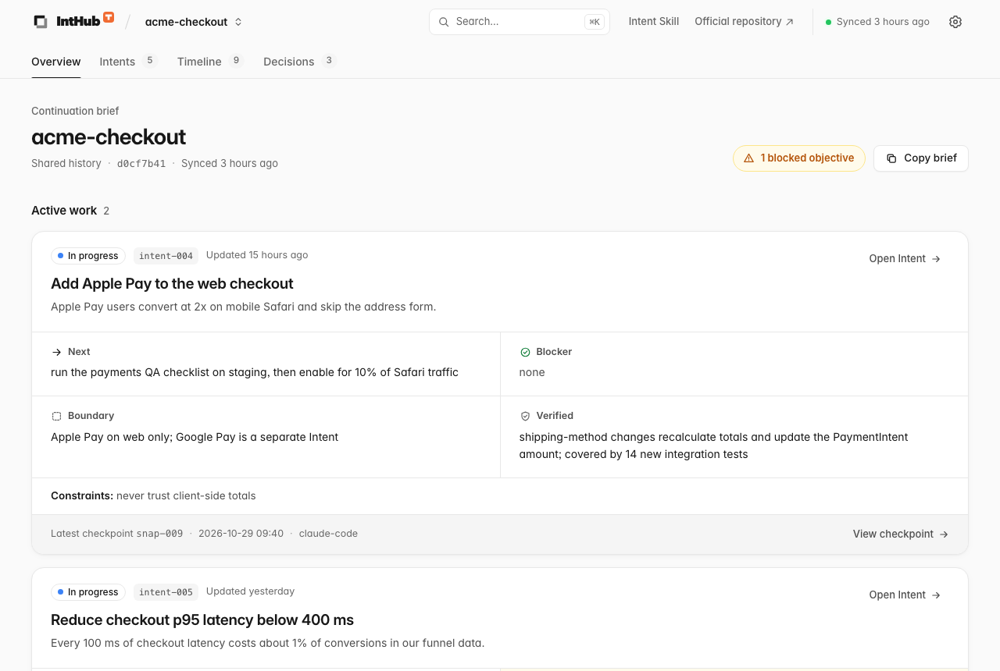

# Intent

[中文](README_CN.md) | English

[](https://github.com/dozybot001/Intent/actions/workflows/test.yml)


**Your coding agent forgets where you left off. Intent keeps the goal, the latest verified checkpoint and the standing decisions in `.intent/`, so the next session (or another agent) continues the work instead of rediscovering it.**

Git records how code changed. Intent records *why*, what is verified, and what comes next, as a small semantic history next to your code.

<picture>
  <source media="(prefers-color-scheme: dark)" srcset="docs/assets/inthub-overview-dark.png">
  
</picture>

## Why not just AGENTS.md or agent memory?

| You may already use | It holds | Intent adds |
|---|---|---|
| `AGENTS.md`, `CLAUDE.md`, Cursor rules | How to work in this repository | Where the work stands: current goal, verified state, next step, blocker |
| Built-in agent memory | Per-tool, opaque notes | Plain JSON in your project that any agent (and you) can read |
| Issues, PRs, ADRs | Team plans and reviews | Checkpoints captured during the work, plus decisions that attach to new goals automatically |
| Git history | What changed in the code | The reasoning, and the boundary of what is actually done |

## How it works

Three kinds of objects, all append-only:

| Object | Captures |
|---|---|
| **Intent** | One goal and why it matters |
| **Snap** | A verified checkpoint: `Verified`, `Boundary`, `Next`, `Blocker`, `Constraints` |
| **Decision** | A durable rule that binds future goals (for example "payments go through PaymentIntents only") |

Intents can also be related: part of, derived from, succeeds, depends on, conflicts with. IntHub's Flow page draws how goals branch, continue and converge, and which Intent each Decision came from ([Intent flow](docs/EN/intent-flow.md)).

With continuous maintenance on, each agent turn opens with the current state (injected by a project hook), the agent records a Snap only when something meaningful is verified, and the turn closes as `recorded`, `no-op` or `failed`. Quiet turns write nothing. A Stop hook checks that the turn was closed; it cannot judge semantic quality.

## Quick start

```bash
# 1. Install the CLI (macOS / Linux). Re-run any time to upgrade.
curl -fsSL https://raw.githubusercontent.com/dozybot001/Intent/main/scripts/install.sh | bash

# 2. Add the agent skill for your agents (needs Node.js; -a cursor etc. also work)
npx skills add dozybot001/Intent -g -a claude-code -a codex

# 3. Turn it on in a project (Git is optional)
cd your-project
itt init    # sets up hooks for the agent you use (or pass --host codex / claude-code)
```

Then trust the project hooks once: in Codex open `/hooks`; in Claude Code trust the folder and confirm both hooks in `/hooks`. Work as usual. To pick up later, tell the agent: *"Resume this project through Intent."*

Windows (PowerShell): `irm https://raw.githubusercontent.com/dozybot001/Intent/main/scripts/install.ps1 | iex`.
With pipx or uv: `pipx install "intent-history @ git+https://github.com/dozybot001/Intent.git@v7.4.0"` (or `uv tool install …`). Requires Python 3.9+ and Git.

## Try it by hand

```bash
itt init
itt intent create "Add Apple Pay to the web checkout" --why "Apple Pay users convert 2x on mobile Safari"
itt snap create "Payment sheet confirms PaymentIntents in test mode" \
  --next "Handle shipping-method changes server-side" --blocker none
itt decision create "Payments go through the PaymentIntent API only" --why "One SCA path"
itt inspect
```

In a terminal, `itt` prints readable text; agents and scripts get JSON (`--json` forces it).

```text
Active
  intent-001  Add Apple Pay to the web checkout
              Next         Handle shipping-method changes server-side
              Blocker      none
              Verified     Payment sheet confirms PaymentIntents in test mode
              snap-001 · 2026-10-30 00:25 · 1 snap

Decisions
  decision-001  Payments go through the PaymentIntent API only
```

`itt log` lists checkpoints like `git log`; `itt show ID` shows one object with its relations.

## Works with

| Host | Support |
|---|---|
| **Codex** | Skill plus project hooks (opening context and Stop closure check): `itt init` |
| **Claude Code** | Skill (or plugin: `/plugin marketplace add dozybot001/Intent`, then `/plugin install intent-cli@intent`) plus project hooks: `itt init --host claude-code`. See [setup and limits](references/claude-code-hooks.md). |
| **Cursor and other agents** | Skill instructions only, best effort |

Hooks are written to project-local files (`.codex/hooks.json`, `.claude/settings.local.json`) and never enable other projects. `itt maintenance off` turns recording off for one project.

## What is stored, and what it costs

- `.intent/` holds plain JSON (`intents/`, `snaps/`, `decisions/`). `itt init` excludes it from Git in this clone only (`.git/info/exclude`) because it may contain internal reasoning; commit it deliberately if your team wants it in Git.
- Each hooked turn adds a compact opening context (hard-capped) and one `itt maintenance close` call. No network access happens unless you push or pull.

## Browse and share with IntHub (optional)

- **Locally:** `itt hub start`, then `itt remote add origin http://127.0.0.1:7210 --project NAME` and `itt push`. IntHub Local serves only same-origin requests on loopback.
- **Hosted:** [inthub.tenon.asia](https://inthub.tenon.asia), operated by 榫卯 Tenon AI. Sign in with a Tenon account, create an access token in the account menu, run `itt auth login`, then `itt push`. Projects are private to your account; deleting the account from the same menu removes its cloud data (your local `.intent/` is untouched).
- **Restore elsewhere:** `itt init`, `itt remote add origin URL --project NAME`, `itt pull`.

Today a project has one shared history: push and pull fast-forward, and if two copies record in parallel, `itt status` reports `diverged` without changing either side. Git-style branches and merges are the next milestone ([design](docs/EN/semantic-git.md)).

## Status

Intent is **beta** (7.x). Within a major version the `.intent/` format and the JSON output stay compatible; breaking changes come with a new major version and a migration. Recording and continuation flows are covered by tests on Python 3.9 to 3.14. Whether Intent measurably reduces re-explaining in real work is still being validated with natural continuation cases; see the [dogfooding protocol](docs/EN/dogfooding.md).

## FAQ

**Does it replace Git, issues or docs?** No. It records the reasoning and the state of work that those tools don't.

**What if the agent records noise?** Zero writes is a valid outcome; the skill records only verified milestones, never per command or per file. Objects are append-only: corrections are new Snaps.

**Is `pip install intent-cli` this project?** No, that PyPI name belongs to an unrelated tool. Intent's distribution is `intent-history`; the command is `itt`.

**Windows?** The CLI and installer support Windows. Claude Code hooks need Git Bash.

## Docs

- [Vision](docs/EN/vision.md): why semantic history matters
- [Continuation case](docs/EN/continuation-case.md): an interruption-to-resumption walkthrough
- [CLI reference](docs/EN/cli.md): commands, objects and the JSON contract
- [Intent flow](docs/EN/intent-flow.md): relations between Intents and the Flow page
- [Semantic Git](docs/EN/semantic-git.md): the Intent 8 design for branches and merges
- [Codex hooks](references/codex-hooks.md) and [Claude Code hooks](references/claude-code-hooks.md)
- [Dogfooding protocol](docs/EN/dogfooding.md)
- Maintainers: [IntHub production deployment](docs/EN/inthub-production.md)

[Contributing](.github/CONTRIBUTING.md) · [Code of conduct](.github/CODE_OF_CONDUCT.md) · [Security](.github/SECURITY.md) · MIT License
