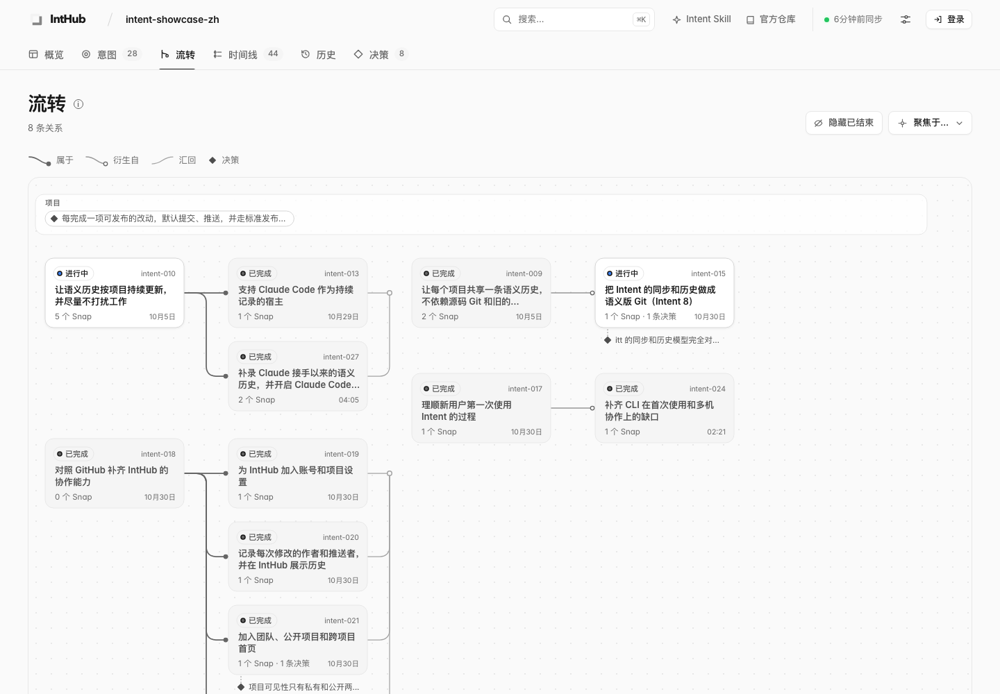

# Intent CLI

Vibe Coding 时代的语义版 Git

[](https://github.com/dozybot001/Intent/actions/workflows/test.yml)
[](https://pypi.org/project/intent-history/)


[官网](https://tenonai.cn/zh/products/intent/) · [文档](#文档) · [IntHub](https://inthub.tenonai.cn) · [English](README.md)


编码 Agent 记不住你上次做到哪里。Intent 把当前目标、最近一次经过验证的检查点和长期决策保存在项目里，下一次会话可以直接接着做，不用重新摸索。Git 记录代码怎么变；Intent 记录为什么这样做、哪些已经验证、下一步是什么。不用登录就能[在 IntHub 上浏览 Intent 自己的历史](https://inthub.tenonai.cn/showcase?lang=zh)。

## 快速开始

```bash
# 1. 安装 CLI（macOS / Linux），重复执行即可升级
curl -fsSL https://gitee.com/dozybot/Intent/raw/main/scripts/install.sh | INTENT_REPO=https://gitee.com/dozybot/Intent.git bash

# 2. 安装 Agent Skill（需要 Node.js）
npx skills add https://gitee.com/dozybot/Intent.git -g -a claude-code -a codex -y

# 3. 在项目中启用（Git 可选）
cd your-project
itt init
```

然后信任一次项目 hooks：Claude Code 中信任该目录，并在 `/hooks` 确认两个 hook；Codex 中打开 `/hooks`。之后照常工作。下次继续时，在任何会话里说一句：

> 通过 Intent 恢复这个项目。

- **访问 GitHub 顺畅时：** 可以把上面两个地址换成 [GitHub 版本](README.md#quick-start)。
- **Windows（PowerShell）：** `irm https://raw.githubusercontent.com/dozybot001/Intent/main/scripts/install.ps1 | iex`。Claude Code hooks 需要 Git Bash。
- **pipx 或 uv：** `pipx install intent-history` 或 `uv tool install intent-history`，需要 Python 3.9+。PyPI 上的 `intent-cli` 是一个无关的工具。
- **Claude Code 插件：** `/plugin marketplace add dozybot001/Intent`，然后 `/plugin install intent-cli@intent`。
- **从 Intent 7 升级：** 在每个项目运行一次 `itt migrate`，它保留所有 ID，并先做备份。

几个名字一句话说清：Intent CLI 是产品，`itt` 是命令，`intent-history` 是安装包，IntHub 是可选的网页应用。

### 手动体验

```bash
itt init
itt intent create "Add Apple Pay to the web checkout" --why "Apple Pay users convert 2x on mobile Safari"
itt snap create "Payment sheet confirms PaymentIntents in test mode" \
  --next "Handle shipping-method changes server-side" --blocker none
itt decision create "Payments go through the PaymentIntent API only" --why "One SCA path"
itt inspect
```

```text
Active
  intent-3f9a2c1  Add Apple Pay to the web checkout
                  Next         Handle shipping-method changes server-side
                  Blocker      none
                  Verified     Payment sheet confirms PaymentIntents in test mode
                  snap-8e41d07 · 2026-10-30 00:25 · 1 snap

Decisions
  decision-c27b5fa  Payments go through the PaymentIntent API only
```

新会话读到的就是这些。在终端中 `itt` 输出文本，Agent 和脚本得到 JSON。

## 功能

- **记录时很轻。** Agent 只在确实验证了有意义的进展时才记检查点，没有变化的轮次什么都不写。
- **恢复时很全。** 一条命令就能让新会话拿到目标、已验证状态、工作边界、下一步和仍然有效的规则。
- **三类只追加的对象。** Intent 是一个目标，Snap 是一个经过验证的检查点，Decision 是约束后续目标的规则。
- **像 Git 一样的历史。** 每次写入都是一个修订，有分支、`log --graph`、`diff`，合并只在真正有分歧时停下。
- **多个 Agent 共享一份历史。** 不同 Git worktree 里的 Agent 各在自己的分支上记录，新 ID 不会冲突。
- **Claude Code 和 Codex 的 hooks。** 每一轮开始时注入当前状态，结束时检查是否收尾；Cursor 等其他 Agent 按 Skill 指令工作。
- **可选的 IntHub。** 在自己的电脑上或 inthub.tenonai.cn 浏览、共享和恢复历史，项目可以私有、团队共享或公开。
- **同一主版本内保持兼容。** `.intent/` 格式和 JSON 输出只随新的主版本和迁移一起改变。

## IntHub

IntHub 是这份历史的可选网页应用。用 `itt hub start` 在自己的电脑上运行，或者用 `itt auth login` 登录 [inthub.tenonai.cn](https://inthub.tenonai.cn)，再用 `itt push` 推送历史。它的「流转」页会画出目标如何分出、接续与汇合。

<picture>
  <source media="(prefers-color-scheme: dark)" srcset="docs/assets/inthub-flow-zh-dark.png">
  
</picture>

## 文档

- [愿景](docs/CN/vision.md)：为什么需要语义历史，以及 AGENTS.md、Agent 记忆和 Git 缺了什么
- [接续案例](docs/CN/continuation-case.md)：从中断到恢复的完整演示
- [CLI 参考](docs/CN/cli.md)：命令、对象、JSON 约定和卸载
- [意图流转](docs/CN/intent-flow.md)：Intent 之间的关系与「流转」页
- [语义版 Git](docs/CN/semantic-git.md)：修订、分支与合并如何工作
- [IntHub 指南](docs/CN/inthub-collaboration.md)：上手、账号、团队与共享
- [Claude Code hooks](references/claude-code-hooks.md) 和 [Codex hooks](references/codex-hooks.md)：配置与限制
- [更新记录](docs/releases/)：每个版本的改动（8.2.7 起附中文）

## 什么留在你的电脑上

- `.intent/` 保存普通 JSON。由于可能包含内部推理，`itt init` 只在当前克隆中把它排除出 Git；如果团队希望放进 Git，请有意识地提交。
- 每个启用 hook 的轮次会注入一段有硬上限的开局上下文，并调用一次 `itt maintenance close`。
- `itt` 只有在你运行 `push`、`pull`、`fetch`、`clone`、`auth`，或在配置了远端时运行 `status`，才访问网络。托管的 IntHub 适用它的[隐私说明](https://inthub.tenonai.cn/privacy#zh)。

## 参与贡献

欢迎用中文或英文提交缺陷报告、功能建议和 Pull Request，见[贡献指南](CONTRIBUTING.md)和[行为准则](CODE_OF_CONDUCT.md)。

## 安全

安全问题请按 [SECURITY.md](SECURITY.md) 私下报告。

## 许可证

[MIT](LICENSE)。Copyright (c) 2026 Changsha Tenon Artificial Intelligence Technology Co., Ltd.（长沙榫卯人工智能科技有限公司）

---

<p>出品方&emsp;&nbsp;<b>榫卯 Tenon AI</b> · <a href="https://tenonai.cn/zh/products/intent/">tenonai.cn</a></p>
