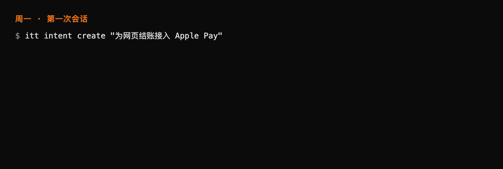
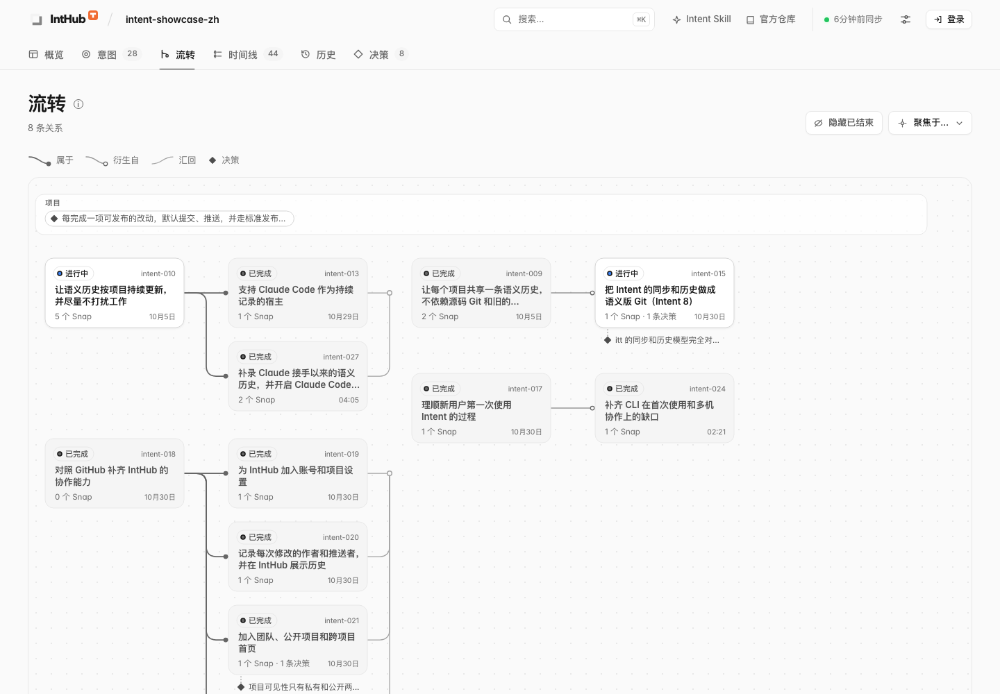

# Intent

中文 | [English](README.md)

[](https://github.com/dozybot001/Intent/actions/workflows/test.yml)
[](https://pypi.org/project/intent-history/)


**编码 Agent 记不住你上次做到哪里。Intent 把当前目标、最近一次经过验证的检查点和长期决策保存在项目里，下一次会话可以直接接着做，不用重新摸索。**

Git 记录代码怎么变；Intent 记录为什么这样做、哪些已经验证、下一步是什么。



**看一个真实项目：**[在 IntHub 上浏览 Intent 自己的历史](https://inthub.tenon.asia/showcase?lang=zh)。这里记录着这个仓库背后的目标、检查点和决策，无需登录。

## 理念

现在你通过 Agent 塑造代码。代码进了 Git，推理却留在对话里，会话一结束就没了。下一个 Agent 从零开始，你只好再讲一遍。

Intent 在代码旁边加了一层很薄的语义历史，核心是一个有意为之的不对称：

- **记录时很轻。** Agent 只在确实验证了有意义的进展时才记一个检查点，没有变化的轮次什么都不写。
- **恢复时很全。** 一条命令就能让下一次会话拿到目标、已验证状态、工作边界、下一步和仍然有效的规则。

历史是 `.intent/` 里的普通 JSON，任何 Agent 都能读，你自己也能读。除非你主动共享，否则数据不会离开你的电脑。

## 快速开始

```bash
# 1. 安装 CLI（macOS / Linux），重复执行即可升级
curl -fsSL https://gitee.com/dozybot/Intent/raw/main/scripts/install.sh | INTENT_REPO=https://gitee.com/dozybot/Intent.git bash

# 2. 安装 Agent Skill（需要 Node.js）
npx skills add https://gitee.com/dozybot/Intent.git -g -a claude-code -a codex -y

# 3. 在项目中启用（Git 可选）
cd your-project
itt init
```

然后信任一次项目 hooks：Claude Code 中信任该目录，并在 `/hooks` 确认两个 hook；Codex 中打开 `/hooks`。之后照常工作。下次继续时，在任何会话里说一句：

> 通过 Intent 恢复这个项目。

访问 GitHub 顺畅时，也可以把上面两个地址换成 [GitHub 版本](README.md#quick-start)。
Windows（PowerShell）：`irm https://raw.githubusercontent.com/dozybot001/Intent/main/scripts/install.ps1 | iex`。
使用 pipx 或 uv：`pipx install intent-history` 或 `uv tool install intent-history`。需要 Python 3.9+。

几个名字一句话说清：Intent 是项目，`itt` 是命令，`intent-history` 是安装包，IntHub 是可选的网页应用。

## 手动体验

```bash
itt init
itt intent create "Add Apple Pay to the web checkout" --why "Apple Pay users convert 2x on mobile Safari"
itt snap create "Payment sheet confirms PaymentIntents in test mode" \
  --next "Handle shipping-method changes server-side" --blocker none
itt decision create "Payments go through the PaymentIntent API only" --why "One SCA path"
itt inspect
```

```text
Active
  intent-3f9a2c1  Add Apple Pay to the web checkout
                  Next         Handle shipping-method changes server-side
                  Blocker      none
                  Verified     Payment sheet confirms PaymentIntents in test mode
                  snap-8e41d07 · 2026-10-30 00:25 · 1 snap

Decisions
  decision-c27b5fa  Payments go through the PaymentIntent API only
```

新会话读到的就是这些。在终端中 `itt` 输出文本，Agent 和脚本得到 JSON。

## 为什么不只用 AGENTS.md 或 Agent 记忆？

| 你可能已经在用 | 它保存的是 | Intent 补上的是 |
|---|---|---|
| `AGENTS.md`、`CLAUDE.md`、Cursor rules | 在这个仓库里应该怎么工作 | 工作进行到哪里：当前目标、已验证状态、下一步、阻塞项 |
| Agent 自带的记忆 | 各工具私有、不透明的笔记 | 项目里的普通 JSON，任何 Agent 和你自己都能读 |
| Issue、PR、ADR | 团队计划与评审 | 工作过程中留下的检查点，以及会自动关联到新目标的决策 |
| Git 历史 | 代码改了什么 | 背后的理由，以及真正完成到哪一步 |

## 记录什么

三类对象，全部只追加：

| 对象 | 记录什么 |
|---|---|
| **Intent** | 一个目标，以及它为什么重要 |
| **Snap** | 一个经过验证的检查点：已验证什么、工作边界、下一步、阻塞项 |
| **Decision** | 约束后续目标的长期规则，例如「支付只走 PaymentIntent」 |

Intent 之间可以建立关系：组成、衍生、继承、依赖、对立。IntHub 的「流转」页会画出目标如何分出、接续与汇合（[意图流转](docs/CN/intent-flow.md)）。

## 像 Git 一样的历史

会用 Git，就知道 Intent 怎么工作。每次写入都是一个修订，不需要提交。

```bash
itt log --graph               # 修订、分支与合并
itt diff HEAD~3               # 改了什么，按目标和检查点而不是按行
itt switch -c experiment      # 像 Git 一样给历史开分支
itt merge experiment          # 合并回来，只有真正的分歧才会停下
```

不同 Git worktree 里的 Agent 共享一份历史，各有自己的分支，新 ID 也不会冲突。合并会自动汇总检查点，只有两边把同一字段改成不同的值才会停下，例如一边把目标标记完成，另一边取消了它。详见[设计](docs/CN/semantic-git.md)。

## 支持的 Agent

| 宿主 | 支持方式 |
|---|---|
| **Claude Code** | Skill（或插件：`/plugin marketplace add dozybot001/Intent`，然后 `/plugin install intent-cli@intent`）加项目 hooks：`itt init --host claude-code`。见[配置与限制](references/claude-code-hooks.md)。 |
| **Codex** | Skill 加项目 hooks：`itt init --host codex`。见[配置与限制](references/codex-hooks.md)。 |
| **Cursor 及其他 Agent** | 仅 Skill 指令，尽力而为 |

Hooks 在每一轮开始时注入当前状态，并在结束时检查这一轮是否完成收尾。它们只写入项目内的文件，不会启用其他项目。`itt maintenance off` 可关闭单个项目的记录。

## 什么留在你的电脑上

- `.intent/` 保存普通 JSON。由于可能包含内部推理，`itt init` 只在当前克隆中把它排除出 Git；如果团队希望放进 Git，请有意识地提交。
- 每个启用 hook 的轮次会注入一段有硬上限的开局上下文，并调用一次 `itt maintenance close`。
- `itt` 只有在你运行 `push`、`pull` 或 `auth` 时才访问网络。

## 用 IntHub 共享（可选）

<picture>
  <source media="(prefers-color-scheme: dark)" srcset="docs/assets/inthub-flow-zh-dark.png">
  
</picture>

- **本地：** `itt hub start`，然后 `itt remote add origin http://127.0.0.1:7210 --project NAME` 和 `itt push`。
- **托管：** [inthub.tenon.asia](https://inthub.tenon.asia)，由榫卯 Tenon AI 运营。运行 `itt auth login`，在浏览器里批准代码，再 `itt push`。每个账号和团队可以保存 100 个项目和 1 GB 历史。项目默认私有，可以共享给团队（`--project 团队/项目`），也可以在项目设置里公开。详见[团队与共享](docs/CN/inthub-collaboration.md)和[隐私说明](https://inthub.tenon.asia/privacy#zh)。
- **在另一处恢复：** 在项目目录运行 `itt clone NAME`，仅限成员。

`itt push` 推送当前分支，`itt pull` 先 fetch 再合并，和 Git 一样。如果两份副本同时记录，`itt status` 会报告 `diverged`，`itt pull` 会合并它们，只有双方把同一字段改成不同值时才停下。

## 状态

Intent 处于 **Beta**（8.x）。从 Intent 7 升级时，在每个项目运行一次 `itt migrate`：它保留所有 ID，并先做备份。同一主版本内，`.intent/` 格式与 JSON 输出保持兼容；不兼容的变化只会随新的主版本和迁移一起发布。记录与接续流程在 Python 3.9 至 3.14 上有测试覆盖。Intent 能否在真实工作中明显减少重复解释，仍在用自然接续案例验证。

## 常见问题

**它会取代 Git、Issue 或文档吗？** 不会。它记录的是这些工具没有记录的理由和工作状态。

**Agent 记录了无用内容怎么办？** 零写入是正常结果。Skill 只记录经过验证的里程碑，从不按命令或文件逐条记录。对象只追加，更正以新的 Snap 表达。

**`pip install intent-cli` 是这个项目吗？** 不是，PyPI 上的这个名字属于一个无关工具。Intent 的安装包是 `intent-history`。

**支持 Windows 吗？** CLI 与安装脚本支持 Windows。Claude Code hooks 需要 Git Bash。

**怎么卸载？** 在每个项目里运行 `itt maintenance off --remove-hooks`，如果也想删除历史，再运行 `rm -rf .intent`。然后运行 `rm -rf ~/.local/share/intent ~/.local/bin/itt` 和 `npx skills remove intent-cli -g`。IntHub 令牌在过期前一直有效，可以在设置里作废。

## 文档

- [愿景](docs/CN/vision.md)：为什么需要语义历史
- [接续案例](docs/CN/continuation-case.md)：从中断到恢复的完整演示
- [CLI 参考](docs/CN/cli.md)：命令、对象与 JSON 约定
- [意图流转](docs/CN/intent-flow.md)：Intent 之间的关系与「流转」页
- [团队与共享](docs/CN/inthub-collaboration.md)：IntHub 的账号、可见性和角色
- [语义版 Git](docs/CN/semantic-git.md)：修订、分支与合并如何工作

[贡献指南](.github/CONTRIBUTING.md) · [行为准则](.github/CODE_OF_CONDUCT.md) · [安全策略](.github/SECURITY.md) · MIT 许可
