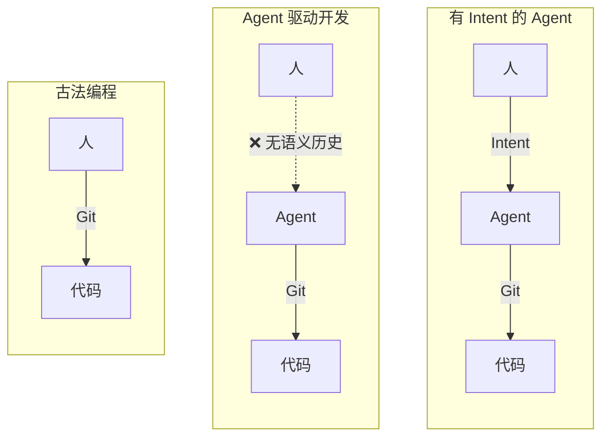

# Intent 的愿景

中文 | [English](../EN/vision.md)

## 核心判断

Git 仍然是代码世界的基础。变化的是写代码的方式：人越来越多地通过 Agent 塑造代码。你提出目标，检查结果，不断修正，再定下长期规则。这个过程产生的知识，Git 从来不负责保存：目标是什么，哪些已经验证，哪些决定仍然有效。这些知识留在一次会话里，会话结束或换一个 Agent，它们就丢了。

所以，通过 Agent 工作的人需要在 Git 之上再加一层，保存这些知识。我们把它叫作语义历史（semantic history），Intent 就是这一层。

**Git 记录代码怎么变，Intent 记录为什么这样做、哪些已经验证、下一步是什么。**

## 现有工具为什么不够

这些信息其实都在，散落在提交说明、Issue、PR 讨论、文档、团队聊天、Agent 对话和个人笔记里。人花时间还能拼起来，新的会话拼不起来：每个工具只掌握一部分，目标和规则没有稳定的边界可供引用，Agent 也没有稳定的入口可以查询。

你能看到代码怎么变了，下面这些问题却很难回答：

- 现在到底在解决什么问题？
- 上一次会话实际完成了什么？
- 为什么选这个方案？
- 哪些长期决策仍然有效？

Intent 把这些答案变成可以引用的对象：每个目标是一个 Intent，每个经过验证的检查点是一个 Snap，每条长期规则是一个 Decision。

## Intent 在哪一层

| 层 | 保存什么 | 典型内容 |
|---|---|---|
| Git | 代码历史 | 提交、分支、差异 |
| Intent | 语义历史 | 目标（Intent）、经过验证的检查点（Snap）、长期规则（Decision） |
| IntHub | 共享与浏览 | 时间线、接续简报、团队权限 |

Intent 是本地、开放的。它在代码旁边的 `.intent/` 里保存普通 JSON，校验这些数据，并为 Agent 提供恢复上下文的入口。

IntHub 是可选的，它和 Intent 的关系类似 GitHub 和 Git。个人和团队用它浏览、共享这份历史，可以用托管版，也可以用 `itt hub start` 在本地运行。项目默认私有，团队可以按角色共享，也可以只读公开。并行记录的副本可以像 Git 一样合并。没有 IntHub，Intent 照样可用，记录也从不依赖它。

## 项目边界

Intent 不打算：

- 替代 Git 的版本控制
- 替代 Issue、PR 或文档系统
- 保存全部对话和中间过程，或成为记录一切的重型平台
- 以远端协作为前提

它只记录值得跟踪、链接、纠偏和复用的内容。

## 记录从轻，恢复从全

Intent 建立在一种刻意的反差上：

- **记录时打扰很少。** 成本低，不打断工作，只保留少量高价值记录。没有重要变化的一轮不写入任何内容。
- **接续时完整恢复。** 新会话能拿到目标、最近经过验证的进展、背后的理由和仍然有效的规则，你不用手动重建上下文。

纠偏也留在历史里：后续的 Snap 说明哪里变了，放弃的 Intent 带原因取消，被替代的 Decision 带原因废弃。

这种反差也是检验这个项目的标准。如果新会话需要重新解释的内容更少，中断的工作更容易续上，决策能一直传下去，Intent 才算成立。这一点还没有得到证明，我们用可复现的[接续案例](continuation-case.md)来检验。
