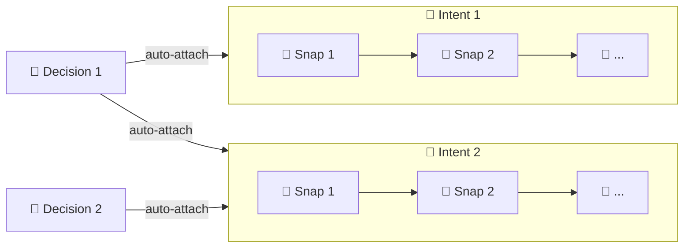
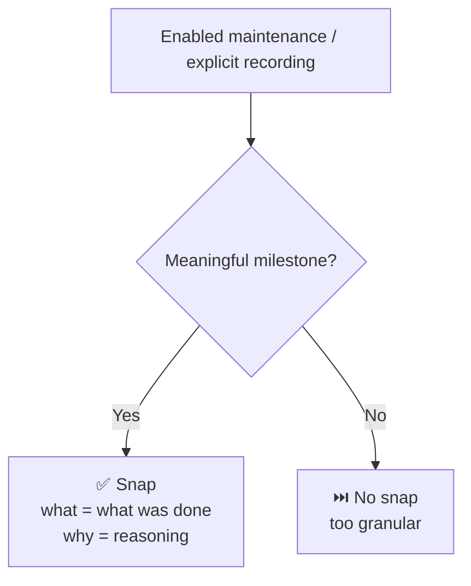
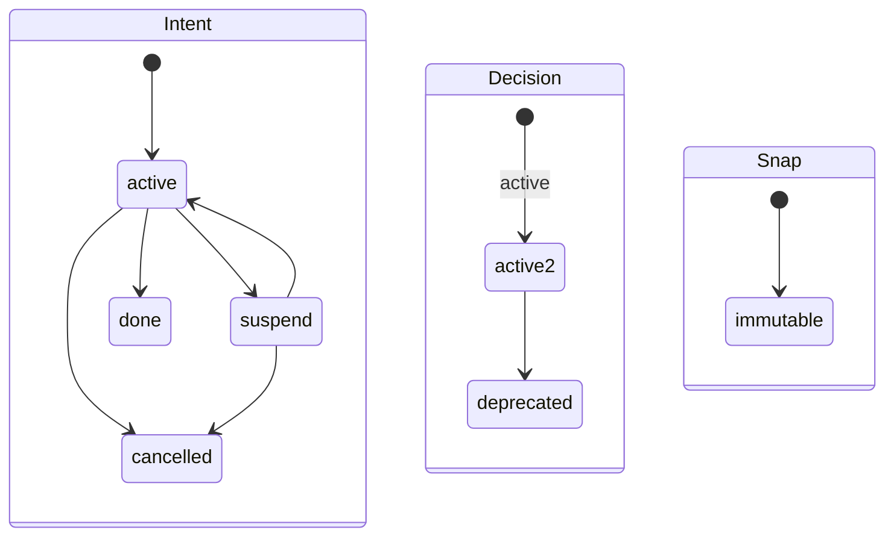

# Intent CLI

[中文](../CN/cli.md) | English

Intent CLI is the local semantic-history CLI for Intent. It manages only three object types:

- `intent`: a recoverable goal
- `snap`: a semantic snapshot — what was done and why
- `decision`: a long-lived constraint across intents

The CLI is intentionally small:

- Recovery: `itt inspect`
- Diagnosis: `itt doctor`
- Browsing: IntHub

## Commands

### Global

| Command | What it does |
|---|---|
| `itt version` | Print CLI version |
| `itt init [--host codex\|claude-code]` | Initialize `.intent/`, enable project-local continuous maintenance, and install local hooks for the host. Without `--host` it uses the agent running the command, else the only agent installed (`~/.codex` or `~/.claude`), else asks at a terminal, else Codex. Git is optional; the hook file is kept out of Git in this clone. |
| `itt inspect [--intent ID] [--history N]` | Recovery view with each goal's rationale, latest snap, optional bounded history, active decisions, and full graph warnings |
| `itt doctor` | Return the same full object-graph diagnosis with an explicit `healthy` result |
| `itt log [--intent ID] [-n N \| --all]` | List Snaps newest first, like `git log` (default 20) |
| `itt show ID` | Show one Intent, Snap or Decision with its relations, like `git show` |

### Project-local continuous maintenance

| Command | Behavior |
|---|---|
| `itt maintenance status [--host H]` | Read this project's flag and the host's hook configuration without initializing; without `--host`, the host this project is configured for. Configuration does not attest execution. |
| `itt maintenance on / off [--host H]` | Enable/disable only this project. Legacy histories need on once; new init defaults on. `on` installs the chosen host's hooks; `off` also removes Intent's Claude Code entries. No global setting changes. |
| `itt maintenance close recorded --turn TOKEN [--objects ID ...]` | Agent acknowledges verified changed objects; IDs may be derived from the entry baseline. |
| `itt maintenance close no-op / failed --turn TOKEN --reason TEXT` | Acknowledge zero writes or failure without manufacturing a Snap. |

The normal loop is read once → preserve important verified milestones → close before responding. Success/no-op are quiet; safely recoverable errors permit continuing after verification, unresolved errors pause only affected history operations. User read-only/skip instructions win. Split independent goals into Intents and verified conclusions into Snaps; no object quota.

`.intent/maintenance.json` contains bounded local flag/receipt metadata, not semantic objects or IntHub snapshot content. Newly generated `.codex/hooks.json` or `.claude/settings.local.json` is locally Git-excluded; unrelated hooks and settings remain intact. Review/trust them in the host's `/hooks`. Stop allows one closure-only retry, not a guarantee against crashes/cancellation or semantic omissions. Hosts without hooks retain a soft Skill contract. See implementation and limits for [Codex](../../references/codex-hooks.md) and [Claude Code](../../references/claude-code-hooks.md), and [tests](../../tests/test_maintenance.py).

### Intent

| Command | What it does |
|---|---|
| `itt intent create WHAT [--why W] [relation flags]` | Create a new intent. Auto-attaches all active decisions. Relation flags are listed below. |
| `itt intent activate [ID]` | `suspend` → `active`. Catches up active decisions. Infers ID when unique. |
| `itt intent suspend [ID]` | `active` → `suspend`. Infers ID when unique. |
| `itt intent done [ID] [--into OTHER]` | `active` → `done` (terminal). Infers ID when unique. `--into` records that OTHER succeeds this intent. |
| `itt intent cancel [ID] [--reason TEXT] [--into OTHER]` | `active` / `suspend` → `cancelled` (terminal). Infers ID when only one open intent exists. `--into` as for `done`; a conflict between the two is resolved into the succession. |
| `itt intent relate ID --part-of/--derived-from/--succeeds/--depends-on/--conflicts-with OTHER` | Record one relation from ID to OTHER. |
| `itt intent unrelate ID OTHER` | Withdraw the active relation between the two intents, whichever side declared it. |

### Relations

Relations exist only between intents ([design](intent-flow.md)). `intent create` accepts `--part-of ID` or `--derived-from ID` (one parent at most) plus repeatable `--succeeds`, `--depends-on` and `--conflicts-with`.

| Flag | Meaning | Derived states |
|---|---|---|
| `--part-of A` | this goal is a part of A; A is not complete until it is done or dropped | `in_progress`, `done`, `dropped`, `orphaned` (A ended first) |
| `--derived-from A` | this goal arose while working on A, which does not need it | none |
| `--succeeds A` | this goal takes over A's aim (next stage, new approach, merged duplicate) | `pending` (A still open), `handed_over` |
| `--depends-on A` | this goal cannot proceed until A is done | `blocked`, `satisfied`, `broken` (A cancelled) |
| `--conflicts-with A` | A and this goal cannot both be achieved as stated | `unresolved`, `resolved` |

A pair of intents has at most one active relation; part of, derived from, succeeds and depends on never form cycles; an ended intent gains no new parts. States are derived from the two statuses and never stored. `inspect` and `show` return active relations in both directions as `{type, direction, intent, state}`.

### Snap

| Command | What it does |
|---|---|
| `itt snap create WHAT [--why W] [--verified T] [--boundary T] [--next T] [--blocker T] [--constraints T]` | Create a semantic snapshot. Auto-attaches to active intent; if multiple, specify `--intent ID`. The optional flags record the continuation checkpoint as structured fields. |

The checkpoint flags write the Snap's optional `checkpoint` object: `verified` (what is now verified, with evidence), `boundary` (what the current work covers and leaves unverified), `next` (the next concrete step), `blocker` (what blocks progress, or `none`), and `constraints` (rules the next agent must keep). Pass only the cell text, without a `Next:`-style label. Values are trimmed, must be non-blank, and are limited to 2,000 characters each. Omitted flags stay absent rather than empty, and a Snap created without any checkpoint flag keeps the legacy shape. IntHub shows recorded cells directly and parses `Label:` text only for Snaps that have no `checkpoint`.

### Decision

| Command | What it does |
|---|---|
| `itt decision create WHAT [--why W] [--from ID]` | Create a long-lived constraint. Auto-attaches all active intents. `--from` names the intent it came from; without it the decision is project-level. |
| `itt decision deprecate ID [--reason TEXT]` | `active` → `deprecated` (terminal). Preserves history; stops future auto-attach. |

### Shared semantic history

Git is optional. Intent owns semantic history independently of the source repository's Git origin.

| Command | Behavior |
|---|---|
| `itt status [--local]` | Report empty / up_to_date / ahead / behind / diverged; --local works offline. |
| `itt remote [-v]` | Show IntHub endpoint and project. |
| `itt remote add origin URL --project NAME` | Configure the shared project; default name is the semantic root directory name. Use `TEAM/NAME` for a team's project. |
| `itt push [--project NAME] [--api-base-url URL] [--dry-run]` | Link when needed, then save a revision. Identical content creates no version; preview has no remote writes. |
| `itt pull [--project NAME] [--api-base-url URL] [--dry-run]` | Advance unchanged local history, preserve local-only changes, reject divergence without overwriting either side. |
| `itt auth login / status / logout` | Account credentials are shared across projects through the credential helper. |
| `itt hub start` | Browse IntHub Local. |

Configure copies with the same remote/project: they share one history instead of separate workspaces. Intent/Snap/Decision remain objects within versions. No staging, manual commit, branch, rebase, force mode, or automatic merge is needed.

A project renamed or transferred on IntHub is followed automatically: `status`, `push` and `pull` look the project up by its ID and report `renamed_from`, and `push` and `pull` store the new name. itt 7.2 and earlier look it up by name and report `REMOTE_CHANGED` until upgraded; team projects need itt 7.5. A project deleted on IntHub also reports `REMOTE_CHANGED`; local history is untouched.

On a team's project, admins and members can push and viewers can pull. Public projects are read on the web: `pull` is for members, because a pull carries author emails.

Revision IDs hash parent and canonical snapshot checksum. Transactional project-head locking rejects competing changes. Lost push responses converge by content without duplicate revisions. Existing append-only and lifecycle constraints still apply.

Workspace sync/export/import protocols have been removed. Copies share the same remote/project independently of Git origin. Hub aliases delegate to the same shared-history implementation.

Implementation: [CLI](../../src/intent_cli/commands/shared.py), [server](../../apps/inthub_api/history.py), [two-client tests](../../tests/test_shared_history.py).

## Object Model



### Snap: what each field carries


### When to create a snap



### State machines



## Object Schema

| Field | Intent | Snap | Decision | Notes |
| --- | :---: | :---: | :---: | --- |
| `id` | ✓ | ✓ | ✓ | Auto-incremented, zero-padded (`intent-001`, `snap-001`, `decision-001`) |
| `object` | ✓ | ✓ | ✓ | `"intent"`, `"snap"`, or `"decision"` |
| `created_at` | ✓ | ✓ | ✓ | ISO 8601 UTC timestamp |
| `what` | ✓ | ✓ | ✓ | Intent/Decision: short theme. Snap: what was done (concise action). |
| `origin` | ✓ | ✓ | ✓ | Auto-detected from environment (e.g. `claude-code`, `cursor`, `codex-desktop`) |
| `author` | ✓ | ✓ | ✓ | Optional `{name, email}` of who recorded it, read the way Git reads its identity |
| `why` | ✓ | ✓ | ✓ | Intent: why this goal. Snap: why this approach. Decision: why this constraint. |
| `status` | ✓ | | ✓ | Intent: `active` / `suspend` / `done` / `cancelled`. Decision: `active` / `deprecated`. |
| `intent_id` | | ✓ | | Parent intent |
| `checkpoint` | | ✓ | | Optional continuation cells from the checkpoint flags: any of `verified`, `boundary`, `next`, `blocker`, `constraints`, each a non-blank string of at most 2,000 characters. Absent when none was recorded. |
| `git` | | ✓ | | Optional commit the Snap was recorded on: `{commit}`, plus `dirty: true` when tracked files had uncommitted changes |
| `snap_ids` | ✓ | | | Ordered list of child snaps |
| `decision_ids` | ✓ | | | Linked decisions (auto-attached on create) |
| `intent_ids` | | | ✓ | Linked intents (auto-attached on create) |
| `reason` | ✓ | | ✓ | Why an intent was cancelled or a decision was deprecated (set via `--reason`) |
| `relations` | ✓ | | | Optional, on the intent that declared them: `{type, intent, created_at}` entries, append-only; a withdrawn entry gains `removed_at` |
| `source_intent_id` | | | ✓ | Optional intent the decision came from (`--from`); absent for project-level decisions |

Once created through the CLI, descriptive fields such as `what`, `why`, `origin`, `author`, `git`, `checkpoint`, `source_intent_id`, and `created_at` are treated as write-once.
Later commands may advance `status`, add `reason`, append auto-maintained relationship fields such as `snap_ids`, `decision_ids`, and `intent_ids`, and append or withdraw `relations` entries.

### Origin detection

`origin` is auto-detected from the process environment:

| Environment signal | Origin label |
|---|---|
| `ITT_ORIGIN` / `INTENT_ORIGIN` | *(custom label)* |
| `CURSOR_TRACE_ID` | `cursor` |
| `CODEX_INTERNAL_ORIGINATOR_OVERRIDE="Codex Desktop"` | `codex-desktop` |
| `CODEX_THREAD_ID` / `CODEX_SHELL` / `CODEX_CI` | `codex` |
| `TERM_PROGRAM=vscode` | `vscode` |
| Codespaces / GitHub Actions / Gitpod env vars | `codespaces` / `github-actions` / `gitpod` |

Priority: explicit `--origin LABEL` > `ITT_ORIGIN` / `INTENT_ORIGIN` > built-in heuristics.

### Author and commit

`author` says who recorded an object; `origin` says which agent did. They work like a commit's author and a `Co-authored-by` line.

| Source, in order | Note |
|---|---|
| `ITT_AUTHOR_NAME`, `ITT_AUTHOR_EMAIL` | Intent only |
| `GIT_AUTHOR_NAME`, `GIT_AUTHOR_EMAIL` | As for a commit |
| Git's `user.name`, `user.email` | Project config, then global |

A missing identity never stops recording: the field is left out, and `itt init`, `itt status` and `itt doctor` warn. Inside a Git repository a Snap also stores `git`.

`itt push` sends the same identity as the declared pusher. It also sends the `origin` remote as a link when that is on github.com, gitlab.com or gitee.com, without credentials, so IntHub can open a Snap's commit.

## JSON Output

In a terminal, `itt` prints readable text for people. It prints the JSON described here whenever stdout is not a terminal (pipes, scripts, agent tools), when an agent host such as Codex or Claude Code is detected, or with `--json` / `ITT_FORMAT=json`; `ITT_FORMAT=text` forces text. Errors in text mode go to stderr as `error:` and `hint:` lines. Set `ITT_DEBUG=1` to see a traceback for an unexpected `INTERNAL_ERROR`.

### Standard success envelope

All successful commands except `inspect` and host-only `maintenance hook` use:

```json
{
  "ok": true,
  "action": "<command-name>",
  "result": {},
  "warnings": []
}
```

### `inspect`

`inspect` returns the context needed to resume recorded work. `active_intents` and `suspended` include the goal's `why`, its complete latest Snap object when one exists, `snap_count`, `has_more`, and `checkpoint`: the latest Snap's structured checkpoint, or `null` when that Snap was recorded without one (older Snaps may still carry the cells as text in `latest_snap`). Each entry also has `relations`: its active relations in both directions, each as `{type, direction, intent: {id, what, status}, state}` (an empty list when there are none). `active_decisions` includes each decision's `why`. In the default view, `has_more` is true when older Snaps exist beyond `latest_snap`.

```json
{
  "ok": true,
  "active_intents": [
    {
      "id": "intent-001",
      "what": "Harden the release flow",
      "why": "partial releases left the workspace inconsistent",
      "snap_count": 3,
      "has_more": true,
      "checkpoint": {
        "verified": "release tests pass; consumers only see complete artifacts",
        "boundary": "publisher only; rollback tooling is unchanged",
        "next": "switch staging to the atomic publisher",
        "blocker": "none"
      },
      "latest_snap": {
        "id": "snap-003",
        "object": "snap",
        "created_at": "2026-07-30T08:00:00+00:00",
        "what": "Made artifact publication atomic",
        "why": "consumers must never observe a partial release",
        "intent_id": "intent-001",
        "origin": "codex",
        "checkpoint": {
          "verified": "release tests pass; consumers only see complete artifacts",
          "boundary": "publisher only; rollback tooling is unchanged",
          "next": "switch staging to the atomic publisher",
          "blocker": "none"
        }
      }
    }
  ],
  "active_decisions": [
    {
      "id": "decision-001",
      "what": "Build before switching the active release",
      "why": "a failed build must leave the current release untouched"
    }
  ],
  "suspended": [
    {
      "id": "intent-002",
      "what": "Replace the legacy publisher",
      "why": "the legacy path is difficult to recover",
      "snap_count": 0,
      "has_more": false,
      "checkpoint": null,
      "latest_snap_id": null,
      "latest_snap": null
    }
  ],
  "warnings": []
}
```

Use `itt inspect --intent intent-001` to focus the recovery view on one active or suspended Intent. Add a positive `--history N` to include `recent_snaps`, containing at most the last N complete Snap objects in their recorded order from oldest to newest. `latest_snap` remains present for compatibility, and the focused entry's `has_more` reports whether additional earlier Snaps exist beyond that bounded selection. `--history` requires `--intent`; completed and cancelled Intent history remains available through IntHub rather than the recovery view.

```json
{
  "snap_count": 5,
  "has_more": true,
  "latest_snap": { "id": "snap-005" },
  "recent_snaps": [
    { "id": "snap-003" },
    { "id": "snap-004" },
    { "id": "snap-005" }
  ]
}
```

`warnings` contains the complete structured issues returned by graph validation, not only orphaned Snaps. Each issue has `code`, `object`, `id`, and `message`; a healthy graph returns an empty list. Run `itt inspect` when resuming recorded work and before adding new semantic records.

### `doctor`

`doctor` runs the same validation used by `inspect.warnings` and wraps the result with an explicit health flag. Unlike strict command reads, it skips each malformed object after recording a structured parse, schema, or integrity issue, so one damaged file does not hide later damage:

```json
{
  "ok": true,
  "action": "doctor",
  "result": {
    "healthy": true,
    "issues": []
  },
  "warnings": []
}
```

### Error envelope

```json
{
  "ok": false,
  "error": {
    "code": "ERROR_CODE",
    "message": "Human-readable explanation.",
    "details": {},
    "suggested_fix": "itt ..."
  }
}
```

## Error Codes

| Code | Meaning |
| --- | --- |
| `NOT_INITIALIZED` | `.intent/` does not exist |
| `MAINTENANCE_STATE_INVALID` | Local maintenance metadata is invalid; no successful closure is claimed |
| `MAINTENANCE_STATE_TOO_LARGE` | Bounded receipt metadata exceeds its size limit |
| `MAINTENANCE_WRITE_FAILED` | Could not persist the flag or receipt |
| `HOOK_CONFIG_INVALID` | Existing hooks are malformed and remain untouched |
| `HOOK_CONFIG_WRITE_FAILED` | Project hooks could not be written; installation is not claimed |
| `TURN_NOT_ACTIVE` | Token is not a valid turn in this enabled project |
| `HISTORY_UNHEALTHY` | Closure found graph issues; diagnose with doctor |
| `RECORDING_UNVERIFIED` | recorded did not reference verifiable objects changed this turn |
| `ALREADY_EXISTS` | `.intent/` already exists when running `init` |
| `STATE_CONFLICT` | Illegal state transition |
| `OBJECT_NOT_FOUND` | Object ID not found |
| `INVALID_INPUT` | Invalid arguments or missing required input |
| `AUTH_REQUIRED` | IntHub rejected the request: no access token was sent or it was not accepted; sign in with `itt auth login` |
| `AUTH_DENIED` / `AUTH_EXPIRED` / `AUTH_CANCELLED` | The `itt auth login` code was refused, expired, or cancelled with Ctrl-C; run it again |
| `INVALID_RELATION` | A relation would relate an intent to itself, duplicate an active relation for the pair, give an intent a second parent, create a cycle, or add a part to an ended intent |
| `INVALID_OBJECT_ID` | An explicit object ID is not a type-matching local ID such as `intent-001` |
| `UNSAFE_STORAGE` | `.intent/`, an object directory, lock, or object file redirects through a symlink or escapes its storage boundary |
| `STORAGE_PARSE_ERROR` | A stored object is not valid UTF-8 JSON; `doctor` reports every parse failure it can scan |
| `STORAGE_SCHEMA_ERROR` | A stored object is missing a required field or has an invalid field type |
| `STORAGE_INTEGRITY_ERROR` | A stored filename and its JSON `id` disagree; inspect and repair the reported local file before retrying |
| `STORAGE_WRITE_CONFLICT` | A create target already exists, or an update target is missing or non-canonical; no existing object is overwritten |
| `STORAGE_SECURITY_ERROR` | Another storage-safety invariant failed |
| `NO_ACTIVE_INTENT` | `snap create`, `intent suspend`, or `intent done` omitted the target intent and none is `active` |
| `MULTIPLE_ACTIVE_INTENTS` | `snap create`, `intent suspend`, or `intent done` omitted the target intent and several are `active` |
| `NO_SUSPENDED_INTENT` | `intent activate` omitted the target intent and none is `suspend` |
| `MULTIPLE_SUSPENDED_INTENTS` | `intent activate` omitted the target intent and several are `suspend` |
| `NO_OPEN_INTENT` | `intent cancel` omitted the target and no intent is `active` or `suspend` |
| `MULTIPLE_OPEN_INTENTS` | `intent cancel` omitted the target and several intents are `active` or `suspend` |
| `WORKSPACE_BUSY` | Another Intent command still holds the workspace write lock; details identify its PID, operation, and start time when available |
| `GLOBAL_CONFIG_ERROR` | The user-level IntHub endpoint config is invalid or cannot be written |
| `CREDENTIAL_STORE_ERROR` | Git's configured credential helper could not persist or remove the account token |
| `HUB_NOT_CONFIGURED` | IntHub API base URL is missing |
| `NOT_LINKED` | Remote shared project is not linked; normal push links it as needed |
| `PERMISSION_DENIED` | The account has read-only access to this team project |
| `TEAM_NOT_FOUND` | The team does not exist or the account is not a member |
| `REMOTE_CHANGED` | Endpoint or project identity changed; select explicitly with remote add |
| `NON_FAST_FORWARD` | Remote changed; push preserved it. Pull first; resolve divergence explicitly |
| `HISTORY_DIVERGED` | Both local and remote changed; neither history was overwritten |
| `HUB_STATE_INVALID` | Local remote or baseline state is malformed |
| `INVALID_LOCAL_SNAPSHOT` | Local Intent history is not a valid complete graph; run `itt doctor` before pulling |
| `INVALID_REMOTE_SNAPSHOT` | The downloaded snapshot identity, version, schema, or graph is invalid |
| `LOCAL_STATE_CHANGED` | Local history or remote configuration changed during synchronization; no overwrite was applied |
| `REMOTE_HISTORY_CONFLICT` | Remote history rewrote, removed, or inconsistently changed recorded data |
| `PULL_APPLY_FAILED` | Workspace-lock-held, journaled snapshot installation or recovery failed; `details.committed` reports whether installation reached committed state, and `details.recovery_required` reports whether another recovery pass is required |
| `NETWORK_ERROR` | IntHub could not be reached |
| `NETWORK_TIMEOUT` | IntHub did not answer within the bounded request timeout; mutation completion may be unknown |
| `SERVER_ERROR` | IntHub returned an error or invalid JSON |

## Operational Notes

- Git is optional. Inside Git repositories, init excludes `.intent/` via clone-local `.git/info/exclude` without editing the shared `.gitignore`; failure returns a warning
- Authentication is global: the default endpoint is user-level, the token uses a credential helper, and project-local hub.json stores only endpoint, shared identity and synchronization baseline
- Intent remote is independent of Git origin. Copies share history by using the same endpoint/project. Workspace-specific protocols have been removed
- Explicit `--token` and `INTHUB_TOKEN` override the stored credential and are never persisted to `hub.json`
- Pull validates and atomically restores shared history, rejecting divergent overwrites; automatic maintenance does not imply pull authorization
- IntHub Local binds to `127.0.0.1` by default, but its current API does not enforce bearer-token authentication and uses permissive CORS; do not expose it to a LAN or the public internet
- The IntHub production profile uses Tenon sign-in and bounded read-only HttpOnly Web sessions; CLI writes use an access token issued by the current account (sent as HTTP `Bearer`), project reads and writes follow the account's ownership and team roles, and production uses PostgreSQL; see [IntHub Production Deployment](inthub-production.md)
- Object and Hub-config replacements are atomic, and mutating object commands use a workspace-level cross-process lock with bounded owner diagnostics; this serializes Intent CLI writers but does not turn `.intent/` into a multi-user database
- IntHub requests use a 15-second per-attempt timeout and at most two attempts; the bundled argv adapter has a 60-second process safety timeout and always emits one JSON document
- Object IDs are validated before path I/O, object paths must remain under their type directory, and `.intent/` object storage refuses symlink redirection
- Descriptive fields are write-once; status and auto-maintained relationship fields evolve through later commands
- IDs are zero-padded and monotonic per object type: `intent-001`, `snap-001`, `decision-001`
