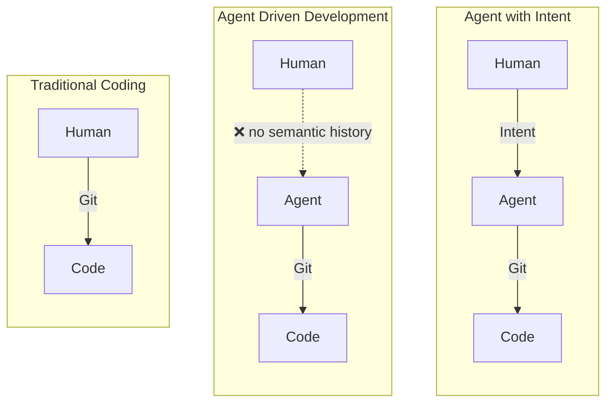

# Intent Vision

[中文](../CN/vision.md) | English

## Core claim

Git remains the foundation of the code world. What has changed is how code gets written. People now shape code through agents: you state a goal, check the result, correct course and settle on rules. That work produces knowledge Git was never built to hold: what the goal is, what has been verified, which decisions still stand. It lives in a session, and when the session ends or the agent changes, it is gone.

So people who work through agents need a layer above Git that keeps this knowledge. We call it semantic history, and Intent is that layer.

**Git records how the code changed. Intent records why, what has been verified, and what comes next.**

## Why existing tools don't cover it

The information already exists. It sits in commit messages, issues, PR discussions, docs, team chat, agent conversations and private notes. A person with time can piece it together. A new session cannot: each tool holds a fragment, a goal or a rule has no stable boundary to reference, and an agent has no stable entry point to query.

You can see how the code changed, yet these questions stay hard to answer:

- What problem are we solving right now?
- What did the last session actually finish?
- Why this approach?
- Which long-term decisions still apply?

Intent turns these answers into objects you can reference: an Intent for each goal, a Snap for each verified checkpoint, and a Decision for each long-term rule.

## Where Intent sits

| Layer | What it keeps | Typical content |
|---|---|---|
| Git | Code history | Commits, branches, diffs |
| Intent | Semantic history | Goals (Intent), verified checkpoints (Snap), long-term rules (Decision) |
| IntHub | Sharing and browsing | Timeline, continuation brief, team access |

Intent is local and open. It keeps plain JSON in `.intent/` beside your code, validates it, and gives agents a way to recover context.

IntHub is optional, and its relation to Intent resembles GitHub's to Git. People and teams use it to browse and share this history, hosted or run locally with `itt hub start`. Projects are private by default. A team can share them by role or publish them read-only. Copies that record in parallel merge, as in Git. Intent stays useful without IntHub, and recording never depends on it.

## Project boundaries

Intent does not try to:

- Replace Git's version control
- Replace issues, PRs or docs
- Store every conversation, or become a heavy platform that records everything
- Require remote collaboration

It records only what is worth tracking, linking, correcting and reusing.

## Light recording, full recovery

Intent is built on a deliberate contrast:

- **Recording is low-disturbance.** It costs little, stays out of your way and keeps only a few high-value records. A turn with nothing important writes nothing.
- **Resuming is a full recovery.** A new session gets the goal, the latest verified progress, the reasoning and the rules still in force. You don't rebuild the session by hand.

Corrections stay in the history. A later Snap explains what changed, a dropped Intent is cancelled with a reason, and a replaced Decision is deprecated with a reason.

This contrast is also the test of the project. Intent works if new sessions need less re-explaining, interrupted work resumes more easily, and decisions carry forward. We have not proven that yet. We check it with reproducible [continuation cases](continuation-case.md).
